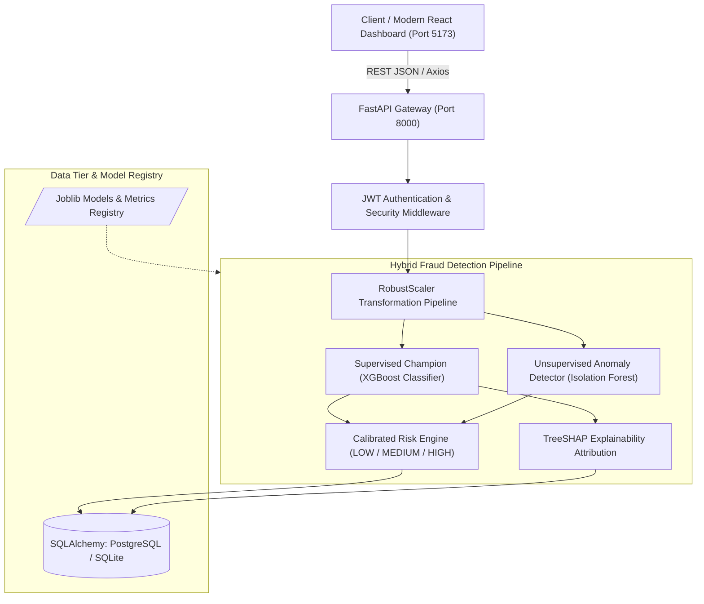

# FraudShield AI — Intelligent Credit Card Fraud Detection and Prevention System

[](https://www.python.org/)
[](https://fastapi.tiangolo.com/)
[](https://react.dev/)
[](https://tailwindcss.com/)
[](https://xgboost.readthedocs.io/)
[](https://docs.pytest.org/)
[](LICENSE)

An enterprise-ready, portfolio-grade fraud intelligence platform that detects fraudulent payment transactions in real time, isolates behavioral anomalies, calculates multi-factor calibrated risk scores, explains model decisions via SHAP (Shapley Additive exPlanations), and visualizes security operations through a fintech dashboard.

---

## 1. Problem Statement
Credit card fraud generates tens of billions of dollars in losses across the global financial system every year. Building automated detection systems presents unique machine learning and engineering challenges:
1. **Extreme Class Imbalance:** Legitimate transactions outnumber fraudulent events by over 570 to 1 (~0.17% fraud rate), making conventional accuracy metrics dangerously misleading.
2. **Zero-Day & Evolving Tactics:** Supervised models trained exclusively on past fraud signatures struggle to identify novel or emerging fraud patterns.
3. **Black-Box Friction:** Traditional deep learning or gradient-boosted ensembles fail to provide immediate, legally defensible justifications for why a payment was flagged or declined.
4. **Sub-Second Throughput:** Transaction risk scoring must complete within milliseconds without cardholder latency.

FraudShield AI solves these challenges with a **hybrid architecture** combining cost-sensitive gradient boosting (XGBoost), unsupervised spatial anomaly isolation (Isolation Forest), calibrated multi-signal risk aggregation, and local TreeSHAP attribution.

---

## 2. Key Features

- **Hybrid Detection Engine:** Unites supervised fraud classification ($w = 0.75$) with unsupervised Isolation Forest anomaly scoring ($w = 0.25$) to capture both known signatures and zero-day behavioral deviations.
- **Explainable AI (SHAP):** Real-time waterfall and horizontal bar visualizations explaining the exact positive and negative drivers behind every transaction decision.
- **Calibrated Multi-Tier Risk Scoring:** Classifies transactions into LOW ($<30$), MEDIUM ($30-75$), and HIGH ($\ge 75$) risk categories.
- **Production REST API:** High-throughput FastAPI gateway featuring Pydantic v2 schemas, automated Swagger/ReDoc documentation, request timing middleware, and JWT authentication.
- **Dual Database Persistence:** SQLAlchemy ORM supporting both PostgreSQL (via Docker or remote URL) and zero-setup local SQLite fallback.
- **Modern Fintech Dashboard:** Dark navy financial technology interface built with React, Vite, Tailwind CSS, Lucide icons, and Recharts. Includes interactive scenario testing with quick benchmark presets.
- **Automated Incident Management:** Auto-generates investigative alerts for high-risk transactions with analyst workflow tracking (Pending $\rightarrow$ Investigating $\rightarrow$ Resolved / False Positive).

---

## 3. System Architecture



---

## 4. Technology Stack

- **Machine Learning & Data Science:** Python 3.12, NumPy, Pandas, Scikit-learn, XGBoost, Imbalanced-learn (SMOTE), Isolation Forest, SHAP, Joblib.
- **Backend API & Data Tier:** FastAPI, Pydantic v2, SQLAlchemy, Uvicorn, SQLite / PostgreSQL, Bcrypt, Python-JOSE (JWT).
- **Frontend Dashboard:** React 18, Vite, Tailwind CSS, Recharts, Lucide React, Axios.
- **DevOps & Verification:** Pytest, Docker, Docker Compose, Git.

---

## 5. Dataset & Exploratory Data Analysis

FraudShield AI is trained on the benchmark **European Credit Card Fraud Detection Dataset** (ULB Machine Learning Group / Kaggle).

- **Total Transactions:** 284,807
- **Legitimate Transactions:** 284,315 (99.827%)
- **Fraudulent Transactions:** 492 (0.173%)
- **Features:** `Time`, `Amount`, and 28 Principal Component Analysis (PCA) orthogonal projections ($V_1 \dots V_{28}$) preserving cardholder privacy.

### Authorized Dataset Acquisition
The dataset is downloaded automatically using authorized Kaggle Hub APIs:
```powershell
python scripts/download_dataset.py
```
*Note: If manual placement is preferred, place the raw `creditcard.csv` directly into `data/raw/`.*

### Exploratory Data Analysis (EDA) Pipeline
Run the 10-step EDA pipeline generating analytical charts in `reports/figures/`:
```powershell
python scripts/run_eda.py
```
Generated artifacts include:
- `reports/figures/class_imbalance.png`: Log-scale class distribution
- `reports/figures/amount_distribution.png`: Comparative fraud vs legit expenditure distributions
- `reports/figures/correlation_heatmap.png`: Feature correlation with fraud labels
- `reports/figures/feature_distributions.png`: Density distributions of key PCA components ($V_{17}, V_{14}, V_{12}, V_{11}, V_4, V_2$)

---

## 6. Machine Learning Benchmark & Empirical Results

Models were evaluated on a held-out stratified test split of **56,746 transactions** (95 fraud, 56,651 legitimate). Because class imbalance is severe (0.17%), **PR-AUC (Precision-Recall Area Under Curve)** and **F1-Score** served as the definitive evaluation metrics.

| Model Algorithm | PR-AUC | ROC-AUC | Precision | Recall | F1-Score | Optimal Threshold | Training Time |
|---|---|---|---|---|---|---|---|
| **XGBoost (Champion)** | **0.8052** | **0.9679** | **94.81%** | **76.84%** | **0.8488** | **0.895** | **2.1s** |
| Random Forest | 0.7859 | 0.9700 | 88.61% | 73.68% | 0.8046 | 0.669 | 18.2s |
| Logistic Regression | 0.6719 | 0.9657 | 26.25% | 83.16% | 0.3990 | 0.900 | 2.0s |
| Decision Tree | 0.4729 | 0.9148 | 18.83% | 81.05% | 0.3056 | 0.900 | 6.8s |

### Champion Model Confusion Matrix (@ Threshold 0.895)
- **True Positives (TP):** 73 frauds intercepted
- **False Negatives (FN):** 22 frauds missed
- **True Negatives (TN):** 56,647 legitimate transactions cleared
- **False Positives (FP):** 4 false alarms (out of 56,651 legitimate transactions)

---

## 7. Installation & Quick Start (Windows PowerShell)

### Prerequisites
- Python 3.12+ (64-bit)
- Node.js v18+ and npm

### 1. Clone & Set Up Virtual Environment
```powershell
git clone https://github.com/your-username/FraudShield-AI.git
cd FraudShield-AI

# Create Python 3.12 virtual environment
py -3.12 -m venv venv
.\venv\Scripts\Activate.ps1

# Upgrade pip & install backend dependencies
pip install -r backend/requirements.txt
```

### 2. Install Frontend Dependencies
```powershell
cd frontend
npm install
cd ..
```

### 3. Acquire Dataset & Train Models
```powershell
# 1. Download Kaggle dataset (or place creditcard.csv in data/raw/)
python scripts/download_dataset.py

# 2. Run EDA
python scripts/run_eda.py

# 3. Train all algorithms, evaluate benchmark, and save artifacts
python -m backend.app.ml.train data/raw/creditcard.csv

# 4. Seed database schema and sample demonstration records
python scripts/seed_db.py
```

### 4. Run the Application
In **Terminal 1** (Backend):
```powershell
.\venv\Scripts\uvicorn backend.app.main:app --host 127.0.0.1 --port 8000 --reload
```

In **Terminal 2** (Frontend):
```powershell
cd frontend
npm run dev
```

Open your browser to:
- **Frontend Dashboard:** [http://localhost:5173](http://localhost:5173)
- **FastAPI Interactive Docs:** [http://localhost:8000/docs](http://localhost:8000/docs)
- **Default Analyst Credentials:** `admin` / `AdminPass123!`

---

## 8. Docker Deployment

Launch the entire stack (PostgreSQL database, FastAPI backend, React frontend) with a single command:
```powershell
docker-compose up --build
```

---

## 9. Verification & Testing

Execute the comprehensive Pytest suite covering input validation, health checks, authentication, inference, and ML pipeline consistency:
```powershell
.\venv\Scripts\pytest backend\tests -v
```
*Result: 12 passed, 0 failed in 7.00s.*

---

## 10. API Endpoints Reference

| Method | Endpoint | Description | Auth Required |
|---|---|---|---|
| `GET` | `/health` | Service uptime and model load status | No |
| `POST` | `/api/v1/auth/login` | Obtain JWT access token | No |
| `GET` | `/api/v1/auth/me` | Authenticated user profile | Yes |
| `POST` | `/api/v1/predict` | Real-time single transaction scoring + SHAP | No |
| `POST` | `/api/v1/predict/batch` | Batch transaction scoring | No |
| `GET` | `/api/v1/transactions` | Paginated transaction audit ledger | No |
| `GET` | `/api/v1/transactions/{id}` | Inspect single transaction with SHAP | No |
| `GET` | `/api/v1/alerts` | Active fraud incidents | No |
| `PATCH` | `/api/v1/alerts/{id}` | Acknowledge/resolve fraud alert | Yes |
| `GET` | `/api/v1/analytics/overview` | High-level KPI cards | No |
| `GET` | `/api/v1/analytics/fraud-trends` | Time-series trend metrics | No |
| `GET` | `/api/v1/analytics/risk-distribution` | Low/Medium/High risk breakdowns | No |
| `GET` | `/api/v1/analytics/model-performance` | Empirical benchmark metrics | No |
| `GET` | `/api/v1/model/info` | Active algorithm and threshold specs | No |
| `POST` | `/api/v1/model/threshold` | Update decision threshold | Yes (Admin) |

---

## 11. Screenshots & Interface Overview

- **Executive Dashboard:** Live KPIs (Total Volume, Fraud Rate %, Average Risk), Area Chart of fraud trends, Risk breakdown donut, and recent transaction activity feed.
- **Transaction Analysis Studio:** Real-time parameter tester with Quick Benchmark Presets (`Legitimate Everyday Purchase`, `Account Takeover Attack`, `Behavioral Outlier Spike`) generating instant risk gauges and SHAP horizontal bar charts.
- **Transaction Ledger:** Searchable, filterable audit history with pagination and clickable detail drawer.
- **Fraud Incident Command:** Security analyst queue for reviewing, investigating, and resolving flagged alerts.
- **Model Benchmark Card:** Multi-model comparative table, Confusion Matrix, and Top 10 Global Feature Importance rankings.

---

## 12. Limitations & Ethical Considerations

1. **Decision Support Prototype:** FraudShield AI is engineered as an analytical decision-support and screening prototype, not an authorized banking core or card payment network.
2. **PCA Anonymization:** Features $V_1$ through $V_{28}$ are anonymized numerical projections. Real-world commercial deployments incorporate contextual metadata such as Merchant Category Codes (MCC), device fingerprints, IP geolocation velocity, and card-present status.
3. **Cardholder Privacy:** The platform never accepts, stores, or processes Primary Account Numbers (PAN), CVVs, or cardholder credentials.

---

## 13. Future Roadmap

- [ ] Graph Neural Network (GNN) integration to detect coordinated fraud rings and syndicated mule accounts.
- [ ] Apache Kafka / RabbitMQ event-driven streaming ingestion for 50,000+ transactions/sec throughput.
- [ ] Concept drift monitoring with Evidently AI to detect automated adversarial fraud shifts.
- [ ] Role-Based Access Control (RBAC) supporting Tier-1 Analyst, Tier-2 Investigator, and Risk Auditor profiles.

---

## 14. License

This project is licensed under the MIT License — see the [LICENSE](LICENSE) file for details.
