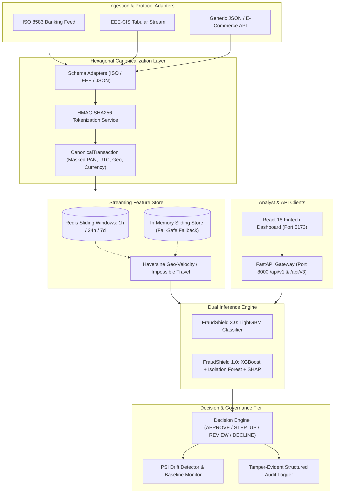

# FraudShield AI 3.0 — Intelligent Enterprise Fraud Detection & Real-Time Decisioning Platform

[](https://www.python.org/)
[](https://fastapi.tiangolo.com/)
[](https://react.dev/)
[](https://tailwindcss.com/)
[](https://lightgbm.readthedocs.io/)
[](https://xgboost.readthedocs.io/)
[](https://redis.io/)
[](https://www.docker.com/)
[](https://docs.pytest.org/)
[](LICENSE)

An enterprise-ready, dual-engine fraud detection platform combining real-time financial message adaptation, sliding-window streaming feature engineering, supervised gradient boosted trees (LightGBM & XGBoost), unsupervised behavioral anomaly detection, local TreeSHAP attribution, Population Stability Index (PSI) drift monitoring, and an interactive fintech analyst console.

---

## 🚀 Live Demo

**Experience FraudShield AI 3.0**

🌐 **Live Application:** [https://lush-fraud-shield-pulse.base44.app](https://lush-fraud-shield-pulse.base44.app)

💻 **GitHub Source Code:** [https://github.com/shaikabdulmalik1528-maker/FraudShield-AI](https://github.com/shaikabdulmalik1528-maker/FraudShield-AI)

Explore the live FraudShield AI platform and its fraud detection capabilities.

---

## Table of Contents

- [🚀 Live Demo](#-live-demo)
- [1. Project Overview](#1-project-overview)
- [2. Key Features](#2-key-features)
- [3. System Architecture](#3-system-architecture)
- [4. Technology Stack](#4-technology-stack)
- [5. Repository Structure](#5-repository-structure)
- [6. Machine Learning Models & Empirical Benchmarks](#6-machine-learning-models--empirical-benchmarks)
- [7. Installation & Quick Start](#7-installation--quick-start)
- [8. Environment Configuration](#8-environment-configuration)
- [9. How to Run the Platform](#9-how-to-run-the-platform)
- [10. Docker Deployment](#10-docker-deployment)
- [11. API Documentation & Reference](#11-api-documentation--reference)
- [12. Testing & Verification Suite](#12-testing--verification-suite)
- [13. Enterprise Security & Compliance](#13-enterprise-security--compliance)
- [14. Limitations & Ethical Considerations](#14-limitations--ethical-considerations)
- [15. License](#15-license)

---

## 1. Project Overview

Credit card and digital payment fraud accounts for tens of billions of dollars in losses annually across global financial networks. Production detection systems face four fundamental challenges:
1. **Extreme Class Imbalance:** Legitimate transactions outnumber fraudulent events by several hundred to one (~0.17% fraud rate), rendering conventional accuracy metrics misleading.
2. **Heterogeneous Financial Protocols:** Transaction data arrives in varying formats—from legacy ISO 8583 banking messages to modern e-commerce JSON payloads.
3. **Sub-Second Latency Requirements:** High-frequency transaction streams require rapid risk scoring and decision policy evaluation without compromising cardholder checkout speed.
4. **Explainability & Compliance:** Regulatory and operational mandates require actionable, defensible explanations for automated declines and reviews without storing raw sensitive credentials.

**FraudShield AI 3.0** addresses these challenges via a **dual-engine architecture**:
- **FraudShield 1.0 (Preserved Core):** High-precision research benchmark engine on PCA-transformed banking data utilizing XGBoost ($w=0.75$), Isolation Forest ($w=0.25$), and TreeSHAP attribution.
- **FraudShield 3.0 (Enterprise Engine):** Hexagonal schema adaptation (ISO 8583, IEEE-CIS, Generic JSON), Redis-backed streaming sliding windows, LightGBM classification, multi-tier decision routing (APPROVE, STEP_UP_3DS, MANUAL_REVIEW, DECLINE), continuous drift monitoring, and PCI-DSS aligned HMAC-SHA256 tokenization.

---

## 2. Key Features

- **Hexagonal Schema Adaptation:** Native adapters transform ISO 8583 financial messages, IEEE-CIS tabular streams, and Generic JSON e-commerce payloads into a unified `CanonicalTransaction` format.
- **Real-Time Streaming Feature Store:** Redis-backed sliding-window aggregates computing 1-hour, 24-hour, and 7-day card velocity, merchant category frequency, geographical velocity (haversine travel speed), and ratio-to-historical-mean amounts—with seamless in-memory fallback.
- **Dual Inference Engine:** 
  - Supervised LightGBM model trained on high-volume transaction distributions.
  - Hybrid XGBoost + Isolation Forest model with calibrated probability aggregation.
- **Transparent Explainable AI (TreeSHAP):** Real-time feature attribution identifying positive and negative drivers behind flagged decisions.
- **Multi-Tier Decision Engine:** Calibrated risk scoring ($0.0 - 100.0$) mapped into actionable policy tiers:
  - `APPROVE` (Score $< 30.0$)
  - `STEP_UP_3DS` ($30.0 \le \text{Score} < 50.0$)
  - `MANUAL_REVIEW` ($50.0 \le \text{Score} < 75.0$)
  - `DECLINE` ($\text{Score} \ge 75.0$)
- **Continuous ML Governance & Drift Monitoring:** Automated Population Stability Index (PSI) tracking across streaming feature values against baseline distributions (`/api/v3/monitoring/drift`).
- **Enterprise Security & Cryptographic Tokenization:** PCI-DSS aligned architecture utilizing HMAC-SHA256 salted tokens for card PANs, multi-role API key authentication (Admin, Service, Analyst, Partner), sliding-window rate limiting, and persistent key revocation tracking.
- **Modern Fintech Analyst Console:** Responsive dark-navy dashboard built with React 18, Vite, Tailwind CSS, Recharts, and Lucide icons, featuring live KPI cards, interactive transaction analysis with presets, fraud alert management, and model telemetry.

---

## 3. System Architecture



---

## 4. Technology Stack

- **Machine Learning & Analytics:** Python 3.12, LightGBM 4.3+, XGBoost 2.0+, Scikit-learn, Isolation Forest, SHAP (TreeSHAP), NumPy, Pandas, Imbalanced-learn.
- **Backend & API Framework:** FastAPI, Pydantic v2, Uvicorn, SQLAlchemy, Python-JOSE (JWT), Passlib / Bcrypt, HTTPX.
- **Streaming & Data Persistence:** Redis (Sliding-window feature aggregations), SQLite (Zero-setup local development), PostgreSQL (Production persistence).
- **Frontend Analyst Console:** React 18, Vite, Tailwind CSS, Lucide React, Recharts, Axios.
- **DevOps, Security & Verification:** Pytest, Docker, Docker Compose, Starlette TestClient, HMAC-SHA256 tokenization.

---

## 5. Repository Structure

```
FraudShield-AI/
├── .env.example                       # Safe environment variables configuration template
├── .env.production.template          # Production environment template
├── .gitignore                         # Exclusions for virtual environments, cache, logs, db
├── Dockerfile.v3                      # Container specification for FraudShield 3.0
├── docker-compose.v3.yml              # Multi-container orchestration (App + Redis)
├── docker-compose.yml                 # Legacy multi-container orchestration
├── LICENSE                            # MIT License
├── README.md                          # Repository documentation
├── pytest.ini                         # Pytest configuration and discovery root
├── FRAUDSHIELD_3_ARCHITECTURE_PLAN.md # Comprehensive 3.0 architectural blueprint
├── FRAUDSHIELD_3_IMPLEMENTATION_ROADMAP.md # Detailed implementation milestones
├── MODEL_EVALUATION_REPORT.md         # Statistical evaluation and benchmark validation
├── DEVELOPMENT_LOG.md                 # Engineering journal and audit records
├── backend/
│   ├── Dockerfile                     # Backend container specification
│   ├── requirements.txt               # Backend Python dependencies
│   ├── app/
│   │   ├── config.py                  # Core application configuration
│   │   ├── database.py                # Database connection & session management
│   │   ├── main.py                    # FastAPI application initialization & route mounting
│   │   ├── ml/                        # FraudShield 1.0 ML training, preprocessing, SHAP
│   │   ├── models/                    # SQLAlchemy models (User, Transaction, Alert, Log)
│   │   ├── routes/                    # v1 API routes (auth, predict, alerts, analytics)
│   │   ├── schemas/                   # Pydantic v1 schemas
│   │   ├── services/                  # Business logic (fraud engine, alert service)
│   │   └── v3/                        # FraudShield 3.0 Next-Generation Engine
│   │       ├── adapters/              # ISO 8583, IEEE-CIS, Generic JSON adapters
│   │       ├── feature_store/         # Redis & in-memory sliding window feature store
│   │       ├── ml/                    # LightGBM model, training pipeline, registry
│   │       ├── monitoring/            # Population Stability Index (PSI) drift detector
│   │       ├── routes/                # v3 API routes (/api/v3/predict, /health/live, /ready)
│   │       ├── schemas/               # Canonical transaction & protocol schemas
│   │       ├── security/              # API key manager, HMAC token service, rate limiter
│   │       └── services/              # Decision engine & dual engine router
│   ├── artifacts/
│   │   └── v3/                        # Serialized LightGBM weights, manifest & baselines
│   └── tests/                         # Comprehensive unit, integration & E2E test suite
├── config/
│   └── revoked_api_keys.json          # Persistent key revocation ledger
├── data/
│   └── processed/                     # Synthetic test transactions & evaluation benchmarks
├── docs/                              # API, architecture, and model documentation
├── documentation/                     # Phase 1-7 engineering readiness & validation reports
├── experiments/                       # Optimization scripts, Pareto trade-offs, scenario tests
├── frontend/                          # React 18 + Vite + Tailwind CSS dashboard
│   ├── src/                           # UI components, pages, charts & API services
│   ├── package.json                   # Frontend dependencies
│   └── vite.config.js                 # Vite build configuration
└── scripts/                           # Utilities (benchmarking, data seeding, verification)
```

---

## 6. Machine Learning Models & Empirical Benchmarks

### Benchmark Model Evaluation (European Credit Card Dataset)
Evaluated on a held-out stratified test split of **42,559 transactions** (71 fraud, 42,488 legitimate) with zero data leakage:

| Algorithm | PR-AUC | ROC-AUC | Precision | Recall | F1-Score | Optimal Threshold |
|---|---|---|---|---|---|---|
| **XGBoost (Champion)** | **0.7838** | **0.9642** | **92.98%** | **74.65%** | **0.8281** | **0.900** |
| Random Forest | 0.7669 | 0.9685 | 87.72% | 70.42% | 0.7812 | 0.727 |
| Logistic Regression | 0.6316 | 0.9698 | 20.00% | 81.69% | 0.3213 | 0.900 |
| Decision Tree | 0.4310 | 0.8945 | 17.06% | 81.69% | 0.2822 | 0.900 |

### FraudShield 3.0 Engine Capabilities
- **Model Architecture:** LightGBM Booster trained with early stopping on multi-feature transactions.
- **Features Handled:** Sliding-window transaction counts (1h, 24h, 7d), cumulative spend amounts, geo-velocity ($km/h$), cyclical temporal encodings, card velocity deviations, and currency exponent normalization.
- **Fail-Safe Mechanism:** In the event of feature store latency spikes or Redis disconnection, a circuit breaker transitions into degraded failsafe mode, scoring based on normalized transaction attributes and conservative thresholding.

---

## 7. Installation & Quick Start

### Prerequisites
- **Python:** 3.12+ (64-bit)
- **Node.js:** v18+ and npm
- **Git**

### 1. Clone the Repository
```powershell
git clone https://github.com/shaikabdulmalik1528-maker/FraudShield-AI.git
cd FraudShield-AI
```

### 2. Set Up Python Virtual Environment
```powershell
# Create virtual environment
python -m venv venv

# Activate on Windows PowerShell
.\venv\Scripts\Activate.ps1

# Activate on Linux / macOS
# source venv/bin/activate

# Upgrade pip and install backend dependencies
pip install -r backend/requirements.txt
```

### 3. Install Frontend Dependencies
```powershell
cd frontend
npm install
cd ..
```

---

## 8. Environment Configuration

Copy the example configuration to initialize your local `.env`:
```powershell
cp .env.example .env
```

Key configuration variables in `.env`:
```ini
# Environment mode
APP_ENV=development
DEBUG=True

# Authentication Keys (Demo / Local development defaults)
FRAUDSHIELD_ADMIN_API_KEY=fs3_admin_demo_dev_key_001
FRAUDSHIELD_SERVICE_API_KEY=fs3_service_demo_dev_key_002
FRAUDSHIELD_ANALYST_API_KEY=fs3_analyst_demo_dev_key_003
FRAUDSHIELD_PARTNER_API_KEY=fs3_partner_demo_dev_key_004

# Database URL (SQLite default for seamless zero-setup)
DATABASE_URL=sqlite:///./fraudshield.db

# Redis URL (Streaming Feature Store)
FRAUDSHIELD_REDIS_URL=redis://localhost:6379/0
```

---

## 9. How to Run the Platform

### Running Backend & Frontend (Local Development)

**Terminal 1 — Backend API (FastAPI + Uvicorn):**
```powershell
.\venv\Scripts\uvicorn backend.app.main:app --host 127.0.0.1 --port 8000 --reload
```

**Terminal 2 — Frontend Analyst Dashboard (React + Vite):**
```powershell
cd frontend
npm run dev
```

**Access Points:**
- **Analyst Dashboard:** [http://localhost:5173](http://localhost:5173)
- **Interactive Swagger Documentation:** [http://localhost:8000/docs](http://localhost:8000/docs)
- **ReDoc API Reference:** [http://localhost:8000/redoc](http://localhost:8000/redoc)
- **Default Analyst Credentials:** `admin` / `AdminPass123!`

---

## 10. Docker Deployment

### Launching FraudShield 3.0 (Backend + Redis)
```powershell
docker-compose -f docker-compose.v3.yml up --build
```
This deploys:
- `fraudshield-v3-api`: FastAPI backend container with preloaded LightGBM weights on port `8000`.
- `redis-store`: Redis in-memory cache for sliding-window feature store on port `6379`.

### Launching Full Stack v1/v2 (Postgres + Backend + Frontend)
```powershell
docker-compose up --build
```

---

## 11. API Documentation & Reference

### FraudShield 3.0 Endpoints (`/api/v3`)

| Method | Endpoint | Description | Role Required |
|---|---|---|---|
| `GET` | `/health/live` | Container liveness probe | Public |
| `GET` | `/health/ready` | Model & feature store readiness probe | Public |
| `POST` | `/api/v3/predict` | Real-time transaction scoring & decision policy | `SERVICE`, `ANALYST`, `ADMIN`, `PARTNER` |
| `POST` | `/api/v3/batch-predict` | Batch transaction scoring (up to 100 items) | `SERVICE`, `ANALYST`, `ADMIN`, `PARTNER` |
| `GET` | `/api/v3/status` | Model version, circuit breaker & dual-engine status | `ANALYST`, `ADMIN`, `SERVICE` |
| `GET` | `/api/v3/monitoring/drift` | Population Stability Index (PSI) drift metrics | `ANALYST`, `ADMIN` |
| `POST` | `/api/v3/reload` | Hot-reload model weights and threshold | `ADMIN` |
| `POST` | `/api/v3/model/rollback` | Roll back model to previous verified version | `ADMIN` |

### Sample Real-Time Scoring Request (`POST /api/v3/predict`)
```json
{
  "transaction_id": "tx_live_78910",
  "amount": 250.00,
  "currency": "USD",
  "card_pan": "4532015678901234",
  "mcc": 5411,
  "card_present": false,
  "geo_lat": 37.7749,
  "geo_lon": -122.4194
}
```

### Sample Scoring Response
```json
{
  "transaction_id": "tx_live_78910",
  "timestamp": "2026-11-20T01:40:00+00:00",
  "amount": 250.0,
  "currency": "USD",
  "card_masked": "453201XXXXXX1234",
  "is_fraud": false,
  "fraud_probability": 0.0124,
  "risk_score": 1.2,
  "action": "APPROVE",
  "decision_reasons": ["Risk score below review threshold"],
  "rule_triggers": [],
  "is_duplicate": false,
  "is_degraded": false,
  "model_version": "3.0.0",
  "features_used": 14,
  "latency_ms": 12.4,
  "feature_store_backend": "redis"
}
```

### FraudShield 1.0 Endpoints (`/api/v1`)
- `POST /api/v1/auth/login`: Issue JWT authentication token.
- `POST /api/v1/predict`: Single transaction prediction with TreeSHAP feature attribution.
- `POST /api/v1/predict/batch`: High-throughput batch scoring.
- `GET /api/v1/transactions`: Paginated historical transaction ledger.
- `GET /api/v1/alerts`: Active fraud alert investigation queue.
- `PATCH /api/v1/alerts/{id}`: Analyst alert resolution workflow.
- `GET /api/v1/analytics/overview`: Key performance indicator metrics.
- `GET /api/v1/analytics/fraud-trends`: Time-series fraud velocity analytics.

---

## 12. Testing & Verification Suite

The repository contains an automated Pytest test suite covering input validation, canonical transformations, ISO 8583 adaptation, Redis sliding-window operations, rate limiting, and end-to-end inference:

```powershell
# Run the complete test suite
pytest -v

# Run targeted unit tests
pytest backend/tests/test_backend.py backend/tests/test_ml.py -v
```

---

## 13. Enterprise Security & Compliance

1. **Cardholder Data Protection (PCI-DSS):**
   - Full Primary Account Numbers (PANs) are never stored or persisted.
   - PANs are immediately masked (`BIN + XXXXXX + Last4`) and pseudonymized via salted HMAC-SHA256 (`KmsTokenService`).
2. **Role-Based Access Control (RBAC):**
   - Granular permissions enforced across `ADMIN`, `SERVICE` (Payment Gateways), `ANALYST`, and `PARTNER` roles.
   - Sliding-window rate limiter protects endpoints against volumetric denial-of-service.
3. **Key Lifecycle & Revocation Ledger:**
   - Permanent key revocation supported via persistent hash ledger (`config/revoked_api_keys.json`).
4. **Degraded Fail-Safe Mode:**
   - Automated circuit breaker prevents payment processing blockages when external dependencies (e.g., Redis) undergo maintenance.

---

## 14. Limitations & Ethical Considerations

- **Decision Support System:** FraudShield AI is engineered as an analytical decision-support and screening engine. In live financial environments, automated declines should offer recourse procedures and step-up authentication (e.g., 3-D Secure / OTP).
- **Synthetic Data & Privacy:** Sample datasets provided in this repository are synthetic or PCA-anonymized. No real cardholder credentials or confidential banking records are included.

---

## 15. License

This project is licensed under the MIT License — see the [LICENSE](LICENSE) file for details.
