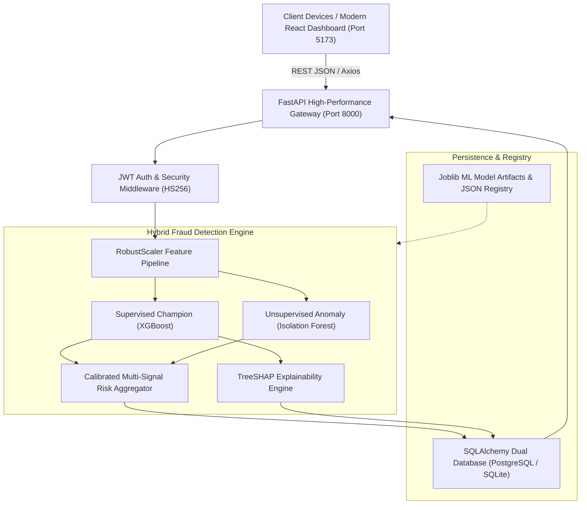

# FraudShield AI — System Architecture & Engineering Blueprint

## Executive Overview
**FraudShield AI** is a defense-in-depth, intelligent credit card fraud screening and prevention platform. It unites supervised gradient boosting, unsupervised spatial outlier isolation, multi-factor risk calibration, and Explainable AI (XAI) via Shapley Additive exPlanations (SHAP) into an enterprise-ready dashboard and REST API.

---

## High-Level System Architecture

---

## Hybrid Risk Scoring Mathematics

In financial fraud detection, relying solely on supervised classification causes false alarms or misses zero-day attack vectors. FraudShield AI employs a dual-signal calibrated risk architecture:

### 1. Calibrated Risk Formula
Given:
- $P_{\text{fraud}} \in [0.0, 1.0]$: Calibrated fraud probability from the supervised XGBoost classifier.
- $S_{\text{anomaly}} \in [0.0, 1.0]$: Normalized anomaly score derived from the Isolation Forest decision function.
- $w_{\text{fraud}} = 0.75$: Weight allocated to supervised patterns learned from historical fraud.
- $w_{\text{anomaly}} = 0.25$: Weight allocated to unsupervised behavioral divergence.

$$\text{Base Risk} = 100 \times \left( w_{\text{fraud}} \cdot P_{\text{fraud}} + w_{\text{anomaly}} \cdot S_{\text{anomaly}} \right)$$

### 2. Guardrail Heuristics
1. **Anomaly Floor:** If Isolation Forest identifies an extreme outlier ($S_{\text{anomaly}} > 0.85$ or `is_anomaly == True`), risk score is bounded to a minimum floor of $45.0$ to trigger manual review.
2. **Threshold Exceedance:** If $P_{\text{fraud}} \ge \tau_{\text{optimal}}$ (where $\tau_{\text{optimal}} = 0.895$), the transaction is elevated to high-risk scrutiny ($\ge 70.0$).

### 3. Risk Bands & Decision Boundaries
- **LOW:** $\text{Risk} < 30.0$ $\rightarrow$ Automatically Cleared (LEGITIMATE)
- **MEDIUM:** $30.0 \le \text{Risk} < 75.0$ $\rightarrow$ Secondary Review Required
- **HIGH:** $\text{Risk} \ge 75.0$ $\rightarrow$ Flagged & Alert Generated (SUSPICIOUS)

---

## Explainable AI (SHAP) Attribution

For every transaction scored, the TreeSHAP engine computes the local Shapley value $\phi_i$ for each feature:

$$f(x) = \phi_0 + \sum_{i=1}^{M} \phi_i$$

Where:
- $\phi_0$ is the expected baseline fraud log-odds over the training background distribution.
- $\phi_i > 0$ represents positive risk drivers (increases fraud likelihood).
- $\phi_i < 0$ represents risk mitigators (decreases fraud likelihood).

To preserve cardholder privacy, anonymized PCA components $V_1 \dots V_{28}$ are explicitly marked as anonymized dimensional embeddings, while monetary amount and temporal offsets are explained directly.
