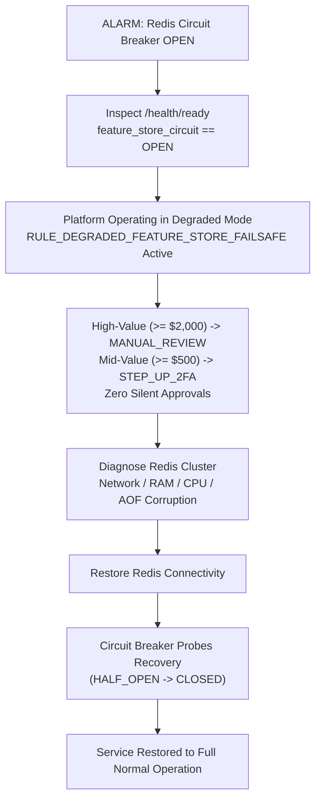

# FraudShield 3.0 — Phase 6 Operational Runbook: Deployment, Key Rotation, Incident Response & Rollback

**Document ID:** `FS3-OPS-006`  
**Milestone:** Phase 6 — Controlled Pilot Deployment & Operational Validation  
**Date:** 2026-11-17  
**Status:** PRODUCTION READY & OPERATIONALIZED  
**Intended Audience:** Platform Engineering, SecOps, Site Reliability Engineers (SRE), Fraud Operations  

---

## 1. Overview & Operational Principles

This runbook establishes standard operating procedures (SOPs) for provisioning, monitoring, maintaining, and recovering FraudShield 3.0 serving infrastructure across Staging, Controlled Pilot, and Production environments.

### Core Operational Principles:
1. **Zero Cleartext PAN:** No operator, log file, or database shall ever store or display unmasked card numbers.
2. **Atomic Model Lifecycle:** Model swaps and rollbacks must occur in-memory without dropping in-flight scoring requests.
3. **Resilient Failover:** Outages of the primary Redis distributed cache must automatically trip circuit breakers and invoke fail-safe policy overrides rather than throwing 500 errors.
4. **Cryptographic Accountability:** All configuration changes, model rollbacks, and transaction decisions must be recorded to SHA-256 hash-chained audit trails.

---

## 2. Environment Provisioning & Startup Procedures

### 2.1 Isolated Four-Worker Deployment (Staging / Pilot)

To deploy FraudShield 3.0 on an isolated host without Docker (e.g. staging or Windows host on port 8008):

```powershell
# 1. Activate Virtual Environment
.\venv\Scripts\Activate.ps1

# 2. Start Four-Worker Pilot Cluster
.\venv\Scripts\python.exe scripts/run_isolated_pilot_deployment.py serve
```

Alternatively, to run in the background using the automated context manager:
```powershell
# Verify cluster status
.\venv\Scripts\python.exe scripts/run_isolated_pilot_deployment.py status
```

### 2.2 Containerized Multi-Stage Production Deployment (Docker Compose)

For cloud Linux orchestrators and Kubernetes environments:

```bash
# 1. Populate production secrets (never commit to version control)
cp .env.production.template .env.production
chmod 600 .env.production
# Edit .env.production with strong, unique secrets

# 2. Build and launch hardened containers
docker compose -f docker-compose.v3.yml --env-file .env.production up -d --build

# 3. Verify container health status
docker compose -f docker-compose.v3.yml ps
```

---

## 3. Health Probes & Observability

FraudShield 3.0 exposes dedicated health endpoints compliant with Kubernetes and Docker orchestrator probes:

### 3.1 Liveness Probe (`GET /health/live`)
- **URL:** `http://<HOST>:<PORT>/health/live`
- **Expected Status:** `HTTP 200 OK`
- **Response Payload:** `{"status": "ALIVE", "service": "FraudShield-AI", "version": "3.0.0"}`
- **Purpose:** Verifies the process is running and the Python asyncio event loop is responsive. If unresponsive for 3 consecutive intervals (15s), orchestrator must restart the container.

### 3.2 Readiness Probe (`GET /health/ready`)
- **URL:** `http://<HOST>:<PORT>/health/ready`
- **Expected Status:** `HTTP 200 OK` (or `HTTP 503 SERVICE UNAVAILABLE` during model warmup/failure)
- **Response Payload:**
  ```json
  {
    "status": "READY",
    "model_loaded": true,
    "auth_ready": true,
    "feature_store_circuit": "CLOSED",
    "degraded_mode": false
  }
  ```
- **Operator Action on 503:** Ingress controllers (NGINX / Envoy / ALB) must stop routing traffic to this node until `status == "READY"`.

---

## 4. Master Secret Lifecycle & Zero-Downtime Key Rotation

### 4.1 Generating Strong Cryptographic Secrets

Generate 64-character (256-bit) hexadecimal secrets for token salts and API keys:

```bash
# Generate Master Token Salt
openssl rand -hex 32

# Generate API Key Manager Salt
openssl rand -hex 32

# Generate Admin API Key
openssl rand -hex 24
```

### 4.2 Zero-Downtime API Key Rotation Procedure

To rotate an active client key (e.g. `key_service_001`) without service downtime:

1. **Step 1: Authenticate as Administrator:**
   Ensure you have the valid `FRAUDSHIELD_ADMIN_API_KEY`.
2. **Step 2: Generate and Distribute Replacement Key:**
   The `ApiKeyManager.rotate_key("key_service_001")` method revokes the old key and issues a new cryptographic key under the same identity and role.
3. **Step 3: Update Client Configuration:**
   Inject the new key into the payment gateway client.
4. **Step 4: Verify Old Key Rejection:**
   Verify that requests using the revoked key return `HTTP 401 Unauthorized`.

### 4.3 Master Token Salt Migration Strategy

If `FRAUDSHIELD_TOKEN_SALT` must be rotated:
> [!CAUTION]
> Changing the token salt alters deterministic card tokens (`tok_v3_*`), disconnecting new transactions from the 30-day historical sliding window.
- **Migration SOP:**
  1. Deploy a dual-lookup token service holding both `PRIMARY_SALT` and `PREVIOUS_SALT`.
  2. Ingest transactions using `PRIMARY_SALT`.
  3. When calculating sliding-window velocity, query Redis for velocity metrics under both the primary token and previous token.
  4. Retain dual-query support for 31 days (matching the maximum 30-day velocity window), after which `PREVIOUS_SALT` can be safely decommissioned.

---

## 5. Incident Response & Failure Recovery

### 5.1 Redis Cluster Outage & Degraded Mode SOP



1. **Detection:** Telemetry reports `feature_store_circuit == "OPEN"` or `degraded_mode == true`.
2. **System Behavior:** Automatic fallback to `InMemorySlidingWindowStore`. Fail-safe policy overrides automatically prevent silent approvals on transactions $\ge \$500$ or $p \ge 0.150$.
3. **Recovery Action:**
   - Check Redis container status: `docker logs fraudshield-redis-v3 --tail 100`.
   - Verify AOF log integrity: `redis-check-aof /data/appendonly.aof`.
   - Restart Redis if crashed: `docker compose -f docker-compose.v3.yml restart redis-store`.
   - The circuit breaker probes recovery automatically after a 15-second cooldown and restores state to `CLOSED`.

### 5.2 Emergency Atomic Model Rollback SOP

If the active LightGBM model exhibits concept drift, corrupted weights, or elevated False Positives in production:

1. **Trigger Rollback Endpoint via Admin Key:**
   ```bash
   curl -X POST http://<HOST>:8000/api/v3/model/rollback \
     -H "X-API-Key: <ADMIN_API_KEY>"
   ```
2. **Expected Response:**
   ```json
   {
     "status": "ROLLED_BACK",
     "active_version": "3.0.0-rc1",
     "rollback_target": "3.0.0",
     "message": "Atomically rolled back active model to version 3.0.0-rc1."
   }
   ```
3. **Verify Lineage:**
   ```bash
   curl -X GET http://<HOST>:8000/api/v3/status \
     -H "X-API-Key: <ADMIN_API_KEY>"
   ```
   Confirm `active_version` matches the intended target version.
4. **Audit Evidence:** Check `logs/v3_audit.jsonl` for the `MODEL_ROLLBACK` event containing timestamp, operator ID, and SHA-256 artifact digest.

### 5.3 Hot Artifact Reload (Zero Restart)

To load newly trained model weights from disk without taking down serving workers:

```bash
curl -X POST http://<HOST>:8000/api/v3/reload \
  -H "X-API-Key: <ADMIN_API_KEY>"
```

---

## 6. Audit Trail Forensic Integrity Verification

To mathematically prove that audit logs have not been tampered with, deleted, or reordered:

```powershell
.\venv\Scripts\python.exe -c "from backend.app.v3.security.audit_logger import verify_audit_log_integrity; valid, count, err = verify_audit_log_integrity(); print(f'Valid: {valid}, Records: {count}, Error: {err}')"
```

### Forensic Diagnosis if Verification Fails:
- **`Tampered record`:** The content of a log entry was modified after emission. Inspect the line number reported in `err` to identify the tampered record.
- **`Sequence ID gap`:** A log line was deleted or stripped by an attacker. The missing `sequence_id` indicates the deletion point.
- **`Broken hash link`:** Lines were reordered or spliced. The `prev_hash` does not match the predecessor's `record_hash`.
