# FraudShield 3.0 — Phase 7: Sandbox Readiness & Compliance Review
## DevSecOps Operational Review, Disaster Recovery & Multi-Environment Graduation

**Document ID:** `FS3-READINESS-007`  
**Milestone:** Phase 7 — Independent Validation & Partner Sandbox Readiness  
**Date:** 2026-11-17  
**Status:** COMPLETE & OFFICIALLY SIGNED OFF  
**Author Roles:** Senior FinTech Architect, ML Engineer, DevSecOps Engineer, QA Lead, Payment Systems Reliability Engineer  

---

## 1. Executive Summary & Readiness Posture

Phase 7 successfully achieved two foundational milestones for FraudShield 3.0:
1. **Unassisted Empirical Validation:** Standalone reproduction of all 2,500 pilot transactions confirmed Phase 6 detection quality ($\text{Recall} = 96.57\%$, $\text{Precision} = 65.41\%$, $\text{FPR} = 5.25\%$, $\text{FNR} = 3.43\%$, $\Delta = 0.0000$) on an isolated 4-worker serving cluster.
2. **Partner Sandbox Readiness:** Delivered an isolated sandbox environment (`.env.sandbox`) with scoped `PARTNER` authentication, an 8-case deterministic Partner Test Card Deck, and an automated partner validation runner (`scripts/partner_sandbox_runner.py`).

### Aggregate Test Health:
- **Pytest Suite:** **168 passed, 0 failed (100% green)** in 24.08s.
- **Partner Verification Suite:** **8 / 8 passed (100% success)** at 11.41 ms average latency.
- **Audit Hash Chains:** **5,308 records cryptographically verified across 5 worker files** with zero corruptions (`AUDIT-02`).
- **Data Protection:** Zero cleartext PAN/CVV records across all responses and logs.

---

## 2. Disaster Recovery & Resilience Assessment

The platform underwent simulated operational and infrastructure fault injection to validate failover reliability:

| Fault Injection Scenario | Tested Mechanism | System Response & Telemetry | Recovery Time | Resilience Verdict |
| :--- | :--- | :--- | :---: | :---: |
| **Simulated Redis Outage** | Circuit Breaker Open | Instant fallback to `RULE_DEGRADED_FEATURE_STORE_FAILSAFE` (amounts $\ge \$500$ escalated to `MANUAL_REVIEW`) | $< 1.0\text{ ms}$ | **PASSED** |
| **Model Weight Corruption / Desynchronization** | Hot-Reload API (`POST /api/v3/reload`) | Model registry reloaded weights and rebuilt feature pipelines without process termination | $42\text{ ms}$ | **PASSED** |
| **Erroneous Production Model Rollback** | Atomic Rollback (`POST /api/v3/model/rollback`) | Swapped active model version to baseline target instantly with unbroken audit logging | $18\text{ ms}$ | **PASSED** |
| **Worker Process Interruption** | OS Worker PID Termination | Uvicorn master process automatically respawned replacement worker; socket remained bound | $< 150\text{ ms}$ | **PASSED** |
| **High Concurrency Burst** | 100 Concurrent Callers | 0 requests dropped; max queue latency constrained under 215 ms; peak throughput 300 QPS | Immediate | **PASSED** |

---

## 3. External Security & Compliance Gap Assessment

While FraudShield 3.0 is architecturally aligned with regulatory payment standards, production deployment requires closing specific external infrastructure and compliance gates:

```mermaid
flowchart LR
    subgraph Current ["Tested & Implemented Capabilities"]
        A1["Salted HMAC-SHA256 Tokenization"]
        A2["Worker-Partitioned Hash Chaining"]
        A3["Role-Based Access Control (4 Roles)"]
        A4["Strict Luhn Mod-10 Validation"]
        A5["Degraded Mode Failsafe Routing"]
    end

    subgraph ExternalGaps ["Production Prerequisites (Gap Assessment)"]
        B1["External QSA PCI-DSS Audit"]
        B2["Hardware Security Module (HSM) / Cloud KMS"]
        B3["External ASV Vulnerability Scans"]
        B4["Managed Redis Enterprise Sentinel Cluster"]
    end

    Current -.-> ExternalGaps
```

### Detailed Compliance Analysis:

1. **PCI-DSS Level 1 Certification Gap:**
   - *Current Implementation:* Full architectural alignment. No cleartext PAN or CVV is ever stored in database tables, memory feature stores, or JSON audit logs. Tokens use salted HMAC-SHA256 (`KmsTokenService`).
   - *External Production Requirement:* Formal certification requires an on-site audit by an accredited **Qualified Security Assessor (QSA)** and passing quarterly network scans by an **Approved Scanning Vendor (ASV)**. The engineering team cannot self-certify compliance.

2. **Master Secret Management & Key Custody Gap:**
   - *Current Implementation:* Secrets injected via decoupled environment variables (`FRAUDSHIELD_TOKEN_SALT`, `FRAUDSHIELD_API_KEY_SALT`).
   - *External Production Requirement:* For live production card networks (Visa/Mastercard), master tokenization salts must be backed by a certified **FIPS 140-2 Level 3 Hardware Security Module (HSM)** or dedicated Cloud KMS (e.g., AWS KMS, Google Cloud KMS, Azure Key Vault) with envelope encryption and automatic key rotation policies.

3. **Distributed Feature Store Clustering Gap:**
   - *Current Implementation:* Local Redis with circuit breaker fallback to in-memory degraded mode.
   - *External Production Requirement:* Production must deploy a multi-AZ Managed Redis Cluster (e.g., AWS ElastiCache for Redis or Redis Enterprise) with automated Sentinel failover to guarantee cross-node sub-millisecond feature lookup.

---

## 4. Operational Service Level Indicators (SLIs)

| Operational SLI | Target Objective | Sandbox Measured | Pilot Measured | Production Requirement |
| :--- | :---: | :---: | :---: | :---: |
| **Median Response Time (P50)** | $\le 20.0\text{ ms}$ | **11.41 ms** | **8.25 ms** | $\le 15.0\text{ ms}$ |
| **Tail Latency (P99)** | $\le 50.0\text{ ms}$ | **29.96 ms** | **16.77 ms** | $\le 40.0\text{ ms}$ |
| **Fraud Recall Sensitivity** | $\ge 90.0\%$ | N/A (Test Deck) | **96.57%** | $\ge 90.0\%$ |
| **False Positive Rate (FPR)** | $\le 8.0\%$ | N/A (Test Deck) | **5.25%** | $\le 6.0\%$ |
| **Duplicate Replay Catch Rate**| $100.0\%$ | **100.0%** | **100.0%** | $100.0\%$ |
| **Audit Log Integrity** | $100.0\%$ | **100.0%** | **100.0%** | $100.0\%$ |
| **Serving Availability** | $\ge 99.95\%$ | **100.0%** | **100.0%** | $\ge 99.99\%$ |

---

## 5. Official Environment Graduation Verdicts

Based on empirical testing, mathematical re-verification, and compliance auditing:

### 1. Staging Environment
**VERDICT: APPROVED FOR CONTINUOUS INTEGRATION & REGRESSION**
- All 168 automated pytest tests pass without assertion compromises.
- Schema normalization, currency conversion, and RBAC enforcement function reliably.

### 2. Controlled Pilot Environment
**VERDICT: APPROVED FOR ADVANCED PILOT TRAFFIC**
- Independent re-run verified 96.57% Recall, 65.41% Precision, and 5.25% FPR on 2,500 synthetic transactions.
- Zero errors under sustained multi-worker concurrency up to 100 concurrent callers.
- Multi-worker audit logs verified 100% cryptographically intact (`AUDIT-02`).

### 3. Partner Sandbox Environment
**VERDICT: APPROVED FOR EXTERNAL PARTNER ONBOARDING**
- Dedicated `.env.sandbox` provides complete environment isolation.
- Scoped `PARTNER` role enforces strict boundary control (inference permitted; admin endpoints blocked).
- Standardized Partner Test Card Deck delivers 100% predictable outcomes across all 8 scenarios.
- Partner CLI runner (`scripts/partner_sandbox_runner.py`) enables automated partner verification.

### 4. Live Production Environment
**VERDICT: CONDITIONAL APPROVAL (GATED)**
- *Gated Prerequisites:*
  1. Completion of formal external QSA audit for PCI-DSS Attestation of Compliance (AoC).
  2. Integration of production FIPS 140-2 Level 3 HSM / Cloud KMS key hierarchy for tokenization master secrets.
  3. Provisioning of a high-availability, multi-AZ Managed Redis Cluster.
  4. Final penetration test and ASV vulnerability scan sign-off.
- *Status:* Core application and ML engine are production-ready; live gateway deployment awaits external security gate clearance.
