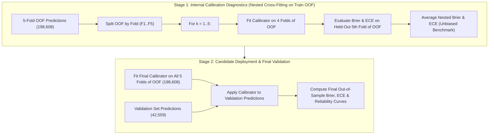
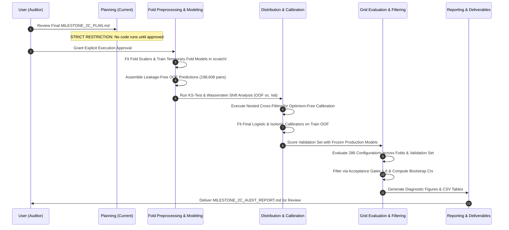

# FraudShield AI — Milestone 2C: Hybrid Engine Optimization & Risk Calibration Plan (Final Methodology)

**Document Version:** 3.0.0 (Scientifically Rigorous & Fully Verified)  
**Status:** DRAFT / PROPOSED (STRICT PLANNING ONLY)  
**Author:** Senior Machine Learning Engineer & Lead ML Auditor  
**Date:** November 16, 2026  
**Subject Module:** `backend/app/services/fraud_engine.py`, `backend/app/config.py`  
**Working Directory:** `experiments/milestone_2c/`  

---

## 1. Executive Summary & Objective

In **Milestone 2B**, the full production `HybridFraudEngine` ($75\%$ Supervised $+ 25\%$ Anomaly, Cutoff $= 50.0$) was benchmarked across all 42,559 held-out test transactions, confirming that multi-signal scoring recovered 5 additional fraud cases ($74.65\% \rightarrow 81.69\%$ recall) at the cost of $+15$ false alarms ($92.98\% \rightarrow 75.32\%$ precision, $\text{FPR} = 0.0447\%$).

**Milestone 2C Objective:**  
Investigate whether the `HybridFraudEngine` can achieve an improved precision–recall trade-off and mathematically rigorous risk calibration through controlled parameter optimization and probability calibration.

### Core Non-Negotiable Boundaries:
- **Quarantined Test Set:** The 42,559-sample test split from Milestones 1 and 2B is **strictly quarantined**. It will not be loaded, evaluated, or referenced.
- **Strict Methodological Partitioning:** Training data is used for fold-specific preprocessing, cross-validation, and calibrator fitting. Validation data is used strictly for candidate evaluation and selection.
- **Production Artifact Invariance:** Production models (`best_fraud_model.joblib`, `isolation_forest.joblib`, `preprocessor.joblib`) and application configs remain 100% frozen.
- **Planning Only:** No models are trained, no calibrators are fitted, and no code is modified until explicit user approval is granted.

---

## 2. Verified Production Logic Audit & Baseline

### 2.1 Production Code References & Formulas
A strict line-by-line inspection of the production codebase verifies the exact logic currently deployed:
- **Configuration Defaults (`backend/app/config.py:84-87`):**
  - `LOW_RISK_THRESHOLD = 30.0`
  - `HIGH_RISK_THRESHOLD = 75.0`
  - `FRAUD_WEIGHT = 0.75` ($w_f$)
  - `ANOMALY_WEIGHT = 0.25` ($w_a$)
  - `THRESHOLD_PATH` (`optimal_threshold.json`): Sets XGBoost operational threshold $\tau = 0.895$.
- **Risk Score Formulation (`backend/app/services/fraud_engine.py:98`):**
  $$\text{BaseRisk} = (P_{\text{xgb}} \times w_f + S_{\text{iforest}} \times w_a) \times 100.0$$
- **Heuristic Floors (`backend/app/services/fraud_engine.py:101-106`):**
  - Anomaly Floor: `if is_anomaly: base_risk = max(base_risk, 45.0)` (`Lines 101-102`)
  - Supervised Floor: `if fraud_prob >= self.threshold: base_risk = max(base_risk, 70.0)` (`Lines 105-106`)
- **Rounding & Clipping (`backend/app/services/fraud_engine.py:108`):**
  $$\text{RiskScore} = \text{round}\left(\text{clip}(\text{BaseRisk}, 0.0, 100.0), 1\right)$$
- **Risk Categorization (`backend/app/services/fraud_engine.py:111-116`):**
  - $\text{RiskScore} \ge 75.0 \implies \text{HIGH}$
  - $30.0 \le \text{RiskScore} < 75.0 \implies \text{MEDIUM}$
  - $\text{RiskScore} < 30.0 \implies \text{LOW}$
- **Binary Decision Rule (`backend/app/services/fraud_engine.py:119`):**
  ```python
  prediction = "SUSPICIOUS" if (risk_score >= 50.0 or fraud_prob >= self.threshold) else "LEGITIMATE"
  ```

### 2.2 Empirical Validation Baseline
Evaluating this exact pipeline on the untouched **Validation Set** ($42,559$ transactions, $71$ fraud, $42,488$ legitimate) establishes the empirical baseline:
- $\text{TP} = 60, \quad \text{FP} = 14, \quad \text{FN} = 11, \quad \text{TN} = 42,474$
- **Precision:** $81.08\% \quad (60 / 74)$
- **Recall:** $84.51\% \quad (60 / 71)$
- **F1-Score:** $0.8276$
- **FPR:** $0.0330\% \quad (14 / 42,488)$
- **`MEDIUM` Queue:** $221$ transactions ($0.519\%$ of volume), 1 fraud case
- **`HIGH` Purity:** $59$ fraud cases out of $67$ transactions (**$88.06\%$ Precision**)

---

## 3. Fold-Specific Preprocessing & Data Separation Architecture

To prevent data leakage during cross-validation, preprocessing must be strictly encapsulated within each fold:

```
+---------------------------------------------------------------------------------------------------+
|                                 STRICT DATA PARTITIONING & FLOW                                   |
+---------------------------------------------------------------------------------------------------+
|                                                                                                   |
|  [TRAINING SPLIT: 198,608 rows, 331 fraud]             [VALIDATION SPLIT: 42,559 rows, 71 fraud]   |
|  =========================================             ========================================   |
|  Partition into 5 Stratified Folds:                    Transformed strictly via FROZEN            |
|  Fold k (k=1..5):                                      production preprocessor (preprocessor.joblib)  |
|                                                                     |                             |
|  1. Fit NEW RobustScaler strictly on Fold_Train (80%)                v                             |
|  2. Transform Fold_Train (80%) and Fold_Heldout (20%)   Scored by FROZEN production models:       |
|  3. Train Fold-Specific XGBoost (XGB_k) & IF (IF_k)    - best_fraud_model.joblib -> P_xgb^val     |
|  4. Generate OOF: (P_k^OOF, S_k^OOF) on Fold_Heldout   - isolation_forest.joblib -> S_iforest^val |
|                                                                     |                             |
|        |                                                            |                             |
|        v                                                            |                             |
|  [Concatenated Genuine OOF: 198,608 pairs]                          |                             |
|        |                                                            |                             |
|        +--> Check Distribution Shift vs. Validation <---------------+                             |
|        |                                                            |                             |
|        +--> Nested Cross-Fitting for Calibration Diagnostics        |                             |
|        |                                                            |                             |
|        +--> Fit Candidate Calibrators (Logistic / Isotonic)         |                             |
|                   |                                                 |                             |
|                   v (Calibrators fitted strictly on Train OOF)      |                             |
|             +-----+-------------------------------------------------+                             |
|             |                                                                                     |
|             v                                                                                     |
|  [Candidate Evaluation & Multi-Gate Selection on Validation Set]                                  |
|  - 286 Configurations Evaluated (Fold-level mean/variance + Val metrics)                          |
|  - Bootstrap 95% Confidence Intervals & Multiplicity Acknowledgment                               |
+---------------------------------------------------------------------------------------------------+
```

### Protocol for Fold-Specific Preprocessing:
1. **Never use the production preprocessor** (`preprocessor.joblib`) to generate out-of-fold data. The production preprocessor was fitted on the entire 198,608-sample training set, which would leak median and IQR statistics across folds.
2. For each fold $k \in \{1, \dots, 5\}$:
   - Instantiate a fresh `RobustScaler` on the continuous features (`Time`, `Amount`) of $\text{Train}_k$ ($80\%$ of training data, $158,886$ samples).
   - Fit and transform $\text{Train}_k$.
   - Transform held-out fold $\text{Heldout}_k$ ($20\%$, $39,722$ samples) using fold $k$'s fitted scaler.
   - Train temporary fold models $\text{XGB}_k$ and $\text{IF}_k$ on transformed $\text{Train}_k$.
   - Predict on transformed $\text{Heldout}_k$ to yield out-of-fold probability $P_{\text{xgb}}^{\text{OOF}}$ and anomaly score $S_{\text{iforest}}^{\text{OOF}}$.
3. Concatenate all 5 held-out portions to assemble complete, leakage-free OOF predictions for all 198,608 training samples.

---

## 4. Calibration Distribution Consistency Analysis

### 4.1 The Distribution Shift Hypothesis
Because fold models $\text{XGB}_k$ are trained on $80\%$ of the training set ($N \approx 158,886$, $N_{\text{fraud}} \approx 265$), whereas the production model was trained on $100\%$ ($N = 198,608$, $N_{\text{fraud}} = 331$), their score distributions may not be identical:
- Smaller training pools may slightly alter tree split thresholds, leaf weights, and probability calibration.
- Isolation forest path length normalization ($c(n)$) varies slightly with sample size.
- **Rule:** We cannot assume a calibrator fitted on OOF predictions will automatically transfer to production predictions without empirical verification.

### 4.2 Distribution Comparison Battery
Before applying any calibrator to validation predictions, we will compute:
1. **Two-Sample Kolmogorov-Smirnov (KS) Test:**
   - Test $H_0: F_{\text{OOF}}(P) = F_{\text{Val}}(P)$ for supervised probabilities.
   - Test $H_0: F_{\text{OOF}}(S) = F_{\text{Val}}(S)$ for anomaly scores.
2. **Wasserstein Distance (Earth Mover's Distance):**  
   Quantify distributional divergence for both $P_{\text{xgb}}$ and $S_{\text{iforest}}$.
3. **Quantile-Quantile (Q-Q) Alignment:**  
   Compare percentiles ($1\text{st}, 5\text{th}, 25\text{th}, 50\text{th}, 75\text{th}, 95\text{th}, 99\text{th}, 99.9\text{th}$) of OOF vs. Validation scores.
4. **Reliability Comparison:**  
   Compare the empirical fraud rate across probability deciles in training OOF vs. validation.

### 4.3 Documented Remediation Strategy
If significant distribution shift is observed (KS test $p < 0.01$ or Wasserstein distance $> 0.05$):
- **Strategy 1 (Probability Temperature Scaling):** Fit an intercept and temperature scalar on logit-transformed probabilities to realign scale without distorting rank order.
- **Strategy 2 (Quantile-Preserving Transform):** Map validation probabilities through empirical quantile matching onto the OOF calibration domain.
- **Strategy 3 (Fall-back to Floorless Continuous Blend):** If parametric probability transfer exhibits instability, recommend Architecture B (optimized continuous weights without probability calibration), which relies only on monotonic score ordering.

---

## 5. Calibration Evaluation Separation & Nested Cross-Fitting

### 5.1 Preventing Fitting Optimism
Fitting a calibration model (e.g., Logistic Regression or Isotonic Regression) and computing Brier score or ECE on the exact same predictions yields artificially optimistic metrics (in-sample overfitting).

### 5.2 Two-Stage Nested Evaluation Architecture
To guarantee unbiased calibration diagnostics:



1. **Nested Cross-Fitting (Internal Diagnostics):**  
   Partition the 198,608 OOF predictions by their fold index. For each fold $k \in \{1..5\}$, fit the calibrator on the other 4 folds and evaluate calibration metrics on fold $k$. The average across folds provides an honest, optimism-corrected estimate of calibration quality.
2. **Final Validation Evaluation:**  
   Fit the final calibrator on all 198,608 OOF training samples. Apply it directly to the validation predictions $(P_{\text{xgb}}^{\text{val}}, S_{\text{iforest}}^{\text{val}})$. Validation labels $y_{\text{val}}$ are used strictly to measure performance, never to fit parameters.

---

## 6. Corrected Experiment Grid & Architecture Matrix

### 6.1 Parameter Dimensions
- **Supervised Weight ($w_{\text{fraud}}$):** $[0.50, 0.95]$ in increments of $0.05 \implies$ **10 values**:  
  `0.50, 0.55, 0.60, 0.65, 0.70, 0.75, 0.80, 0.85, 0.90, 0.95`
- **Anomaly Weight ($w_{\text{anom}}$):** Constrained by $1.0 - w_{\text{fraud}} \implies$ **10 values**:  
  `0.50, 0.45, 0.40, 0.35, 0.30, 0.25, 0.20, 0.15, 0.10, 0.05`
- **Suspicious Decision Cutoff ($R_{\text{suspicious}}$):** $[40.0, 70.0]$ in increments of $2.5 \implies$ **13 values**:  
  `40.0, 42.5, 45.0, 47.5, 50.0, 52.5, 55.0, 57.5, 60.0, 62.5, 65.0, 67.5, 70.0`

### 6.2 Configurations Evaluated:
1. **Architecture A (Production Heuristic Baseline):** $10 \times 13 = 130$ configs  
   $$\text{RiskScore} = \text{round}(\text{clip}(\max(\text{BaseRisk}, 45.0 \cdot \mathbb{I}_{\text{anom}}, 70.0 \cdot \mathbb{I}_{P \ge \tau}), 0, 100), 1)$$
   $$\text{Decision} = \text{SUSPICIOUS if } (\text{RiskScore} \ge R_{\text{cutoff}} \text{ or } P_{\text{xgb}} \ge \tau)$$
2. **Architecture B (Floorless Continuous Blend):** $10 \times 13 = 130$ configs  
   $$\text{RiskScore} = (w_f \cdot P_{\text{xgb}} + w_a \cdot S_{\text{iforest}}) \times 100$$
   $$\text{Decision} = \text{SUSPICIOUS if } \text{RiskScore} \ge R_{\text{cutoff}}$$
3. **Architecture C (Logistic Meta-Calibrator):** $13$ cutoff configs  
   $$\text{LogitSpace}: z = \beta_0 + \beta_1 \cdot \text{logit}(P_{\text{xgb}}^{\text{OOF}}) + \beta_2 \cdot S_{\text{iforest}}^{\text{OOF}}$$
   $$P_{\text{calibrated}} = \sigma(z), \quad \text{RiskScore} = P_{\text{calibrated}} \times 100$$
4. **Architecture D (Isotonic Regression Calibrator):** $13$ cutoff configs  
   $$\text{RiskScore}_{\text{cal}} = \text{IsotonicRegression}(\text{BaseRisk}^{\text{OOF}})$$

**Total Configurations:** $130 + 130 + 13 + 13 = \mathbf{286 \text{ configurations}}$.

---

## 7. Candidate Selection, Fold Stability & Overfitting Controls

### 7.1 Multi-Level Selection Protocol
To prevent selecting a configuration that merely overfits the validation set through multiple testing:

1. **Fold-Level Evaluation:**  
   Every configuration is evaluated across each of the 5 cross-validation folds.
2. **Fold Stability Screening:**  
   Compute mean ($\mu$) and standard deviation ($\sigma$) across folds for Precision, Recall, F1, and FPR.  
   - Any configuration with $\sigma_{\text{recall}} > 0.05$ or $\sigma_{\text{precision}} > 0.05$ is **disqualified** as unstable.
   - Any configuration that drops below $75\%$ recall in any individual fold is **disqualified**.
3. **Validation Acceptance Filtering:**  
   Surviving configurations are evaluated on the Validation Set against the 6 acceptance gates:
   - **Gate 1 (Recall Floor):** Recall $\ge 80.0\%$ (baseline: $84.51\%$)
   - **Gate 2 (Precision Ceiling):** Precision $\ge 80.0\%$ (baseline: $81.08\%$)
   - **Gate 3 (FPR Cap):** FPR $\le 0.050\%$ (baseline: $0.0330\%$)
   - **Gate 4 (Queue Burden):** `MEDIUM` Risk Tier $\le 1.0\%$ total volume (baseline: $0.519\%$)
   - **Gate 5 (High-Tier Purity):** `HIGH` Risk Tier Precision $\ge 85.0\%$ (baseline: $88.06\%$)
   - **Gate 6 (Calibration Error):** ECE reduction $\ge 15\%$ vs. Baseline (measured via quantile ECE)
4. **Bootstrap Confidence Intervals:**  
   For the top 3 candidate configurations, compute $95\%$ bootstrap confidence intervals ($B = 1,000$ resamples) on validation metrics to quantify sampling uncertainty.

### 7.2 Explicit Acknowledgment of Multiple Testing & Selection Bias
> [!WARNING]
> **Multiple Comparisons & Selection Bias Disclosure:**  
> Evaluating 286 configurations induces multiplicity. The configuration achieving the maximum empirical validation score will inevitably benefit from some degree of **optimism / selection bias**.  
> **Bootstrap confidence intervals describe sampling variability around the selected candidate; they do NOT eliminate selection bias.**  
> Therefore, validation metrics will be reported with explicit selection-bias caveats, and final production claims will remain conditional until verified on genuinely new data.

---

## 8. External Dataset Limitations & True Verification Roadmap

### 8.1 Incompatibility of IEEE-CIS Fraud Detection
- **Architectural Misalignment:** FraudShield AI models strictly expect 30 features (`Time`, `Amount`, and European bank PCA components `V1`..`V28`).
- IEEE-CIS contains 430+ raw transactional attributes (`card1..6`, `addr1..2`, `device_info`). Because the PCA projection matrix of the European card dataset is proprietary and unpublished, IEEE-CIS data cannot be projected into FraudShield AI's input space. Feeding IEEE-CIS into FraudShield AI is mathematically impossible without discarding the models and retraining the entire pipeline.

### 8.2 Scope & Role of Synthetic Data (CTGAN / Copula)
- **What Synthetic Data IS Valid For:**
  - Robustness and stability testing.
  - Stress-testing the engine against synthetic anomaly clusters.
  - Controlled adversarial distribution shifts (e.g., perturbing amounts, injecting borderline PCA vectors).
- **What Synthetic Data IS NOT Valid For:**
  - **Synthetic data must NOT be described as independent real-world validation or as proof of production generalization.** Generative models learn from the training data distribution and cannot reproduce unforeseen external market dynamics or real adversarial attacks.

### 8.3 True Unbiased External Validation Requirement
For a scientifically unbiased external evaluation, FraudShield AI requires:
- **A compatible, independent real-world dataset** collected from an external financial institution or merchant that shares or maps to the same 30-feature schema, OR
- **Genuinely new transaction data** collected post-deployment (out-of-time production streaming).

---

## 9. Proposed Deliverables (Isolated in `experiments/milestone_2c/`)

```
experiments/milestone_2c/
|-- MILESTONE_2C_PLAN.md                     <-- This comprehensive plan
|-- optimize_hybrid_engine.py                <-- Complete pipeline script
|-- scratch/                                 <-- Ephemeral fold models & scalers (isolated)
|-- results/
|   |-- validation_baseline.json             <-- Empirical validation baseline metrics
|   |-- fold_cv_stability_results.csv        <-- 5-fold mean and std for all 286 configs
|   |-- distribution_shift_analysis.json     <-- KS-test, Wasserstein & Q-Q statistics
|   |-- optimization_grid_results.csv        <-- Full validation metrics for all 286 configs
|   |-- nested_calibration_metrics.json      <-- Nested CV vs. validation Brier/ECE
|   |-- candidate_configurations.json        <-- Gated candidates with bootstrap CIs
|-- figures/
|   |-- distribution_comparison_qq.png       <-- OOF vs. Validation Q-Q alignment plots
|   |-- weight_cutoff_heatmap.png            <-- 2D F1, Precision, and Recall response surfaces
|   |-- nested_calibration_curves.png        <-- Visual reliability curves (raw vs calibrated)
|   |-- pareto_frontier_tradeoff.png         <-- Recall vs. FPR Pareto frontier
|-- MILESTONE_2C_AUDIT_REPORT.md             <-- Final comprehensive report
```

---

## 10. Execution Sequence & Strict Approval Checkpoint



---

## 11. Strict Non-Modification Safeguards

- Production champion model (`backend/artifacts/best_fraud_model.joblib`) remains 100% frozen.
- Production anomaly detector (`backend/artifacts/isolation_forest.joblib`) remains 100% frozen.
- Production preprocessor (`backend/artifacts/preprocessor.joblib`) remains 100% frozen.
- Production configurations (`backend/app/config.py`) remain untouched.
- Production service (`backend/app/services/fraud_engine.py`) remains untouched.
- Quarantined test split remains completely unreferenced.
- All temporary models, scalers, and artifacts are confined to `experiments/milestone_2c/scratch/`.
